<p align="center">
  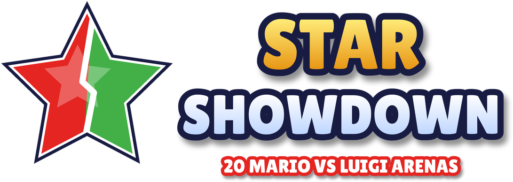
</p>

<p align="center">
  <b>Een Mario vs Luigi rom hack voor New Super Mario Bros. (DS, Europese versie)</b><br>
  20 arena's &middot; geen story mode &middot; ROM van 33,5 MB naar 18 MB
</p>

---

**Star Showdown** draait helemaal om de Mario vs Luigi modus. Bovenop de vijf originele stages komen vijftien nieuwe arena's, verdeeld over vier pagina's in het stagekeuzemenu. De story mode is eruit gehaald, waardoor de ROM bijna de helft kleiner is.

Deze repository bevat geen ROM. Het bouwscript past alle wijzigingen toe op je eigen, legaal verkregen ROM.

<p align="center">
  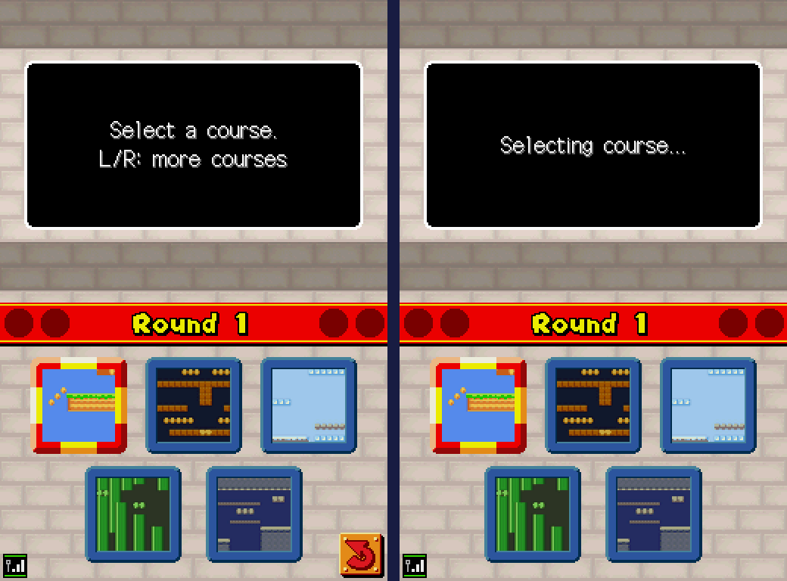<br>
  <i>Het stagekeuzemenu op de host (links) en de tweede speler (rechts). R bladert naar de volgende pagina, L terug.</i>
</p>

## In het kort

| | |
|---|---|
| **Stages** | 20: de 5 originele plus 15 nieuwe |
| **Bladeren** | R volgende pagina, L vorige pagina; de thumbnails wisselen mee |
| **Course: Random** | kiest uit alle 20 stages |
| **Titelmenu** | "Mario Game" start ook Mario vs Luigi; Minigames en Options werken gewoon |
| **ROM-grootte** | 18 MB in plaats van 33,5 MB |
| **Versie** | alleen de Europese ROM (En, Fr, De, Es, It) |

Elke plek op een pagina hoort bij een thema: plek 1 is gras, 2 ondergronds, 3 ijs, 4 pijpen en 5 kasteel. Zo gebruikt een nieuwe stage altijd de tileset, achtergrond en vijanden die de game voor dat thema klaarzet.

## De nieuwe stages

Alle screenshots komen uit een echte 2-speler wedstrijd: links het scherm van Mario, rechts dat van Luigi. Onder elke stage staat een kaart van het hele level.

### Pagina 2

#### Heuvelrug
Een hoge centrale heuvel met verhoogde uiteinden en drie afgronden. De zwevende blokken zijn een springplank naar de sterren.

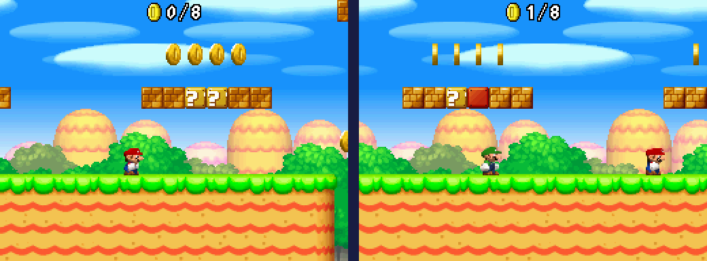
<details><summary>Kaart</summary></details>

#### Steengroeve
Een symmetrische grot met richels op vijf hoogtes en een stenen verhoging in het midden.

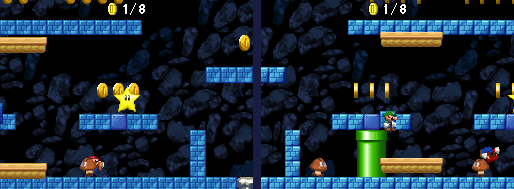
<details><summary>Kaart</summary></details>

#### IJsbaan
Een brede sneeuwvlakte met ijsplatforms, hoogteverschillen en drie afgronden.

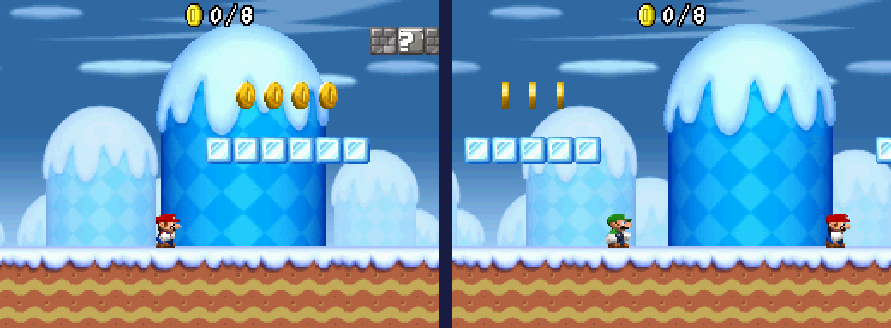
<details><summary>Kaart</summary></details>

#### Buizenstelsel
Pijpen van verschillende hoogte met piranhaplanten. De warppijpen aan de zijkanten van het origineel zijn gebleven.

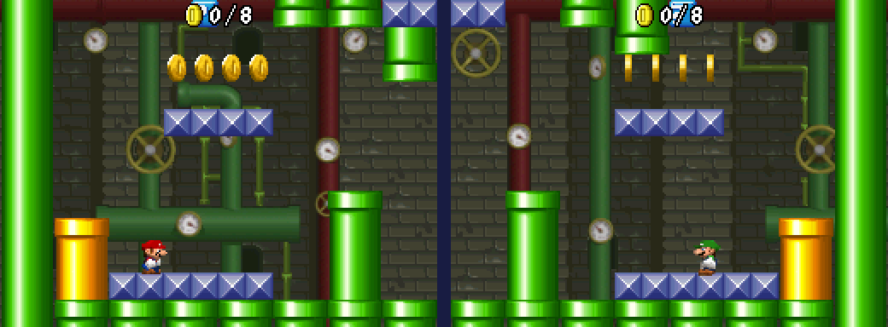
<details><summary>Kaart</summary>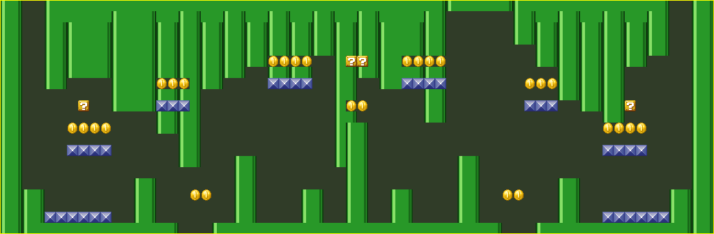</details>

#### Kantelen
Vier torens van oplopende hoogte en een lange brug boven een lage middenmuur.

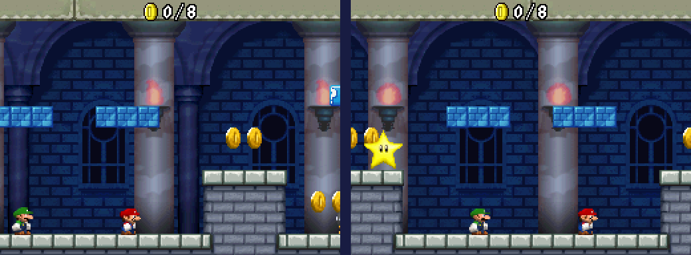
<details><summary>Kaart</summary>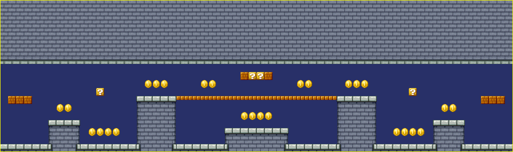</details>

### Pagina 3

#### Zweefeilanden
Er is geen grond: alleen graseilanden boven het niets. Deze stage heeft een hogere camera dan de originele arena's.

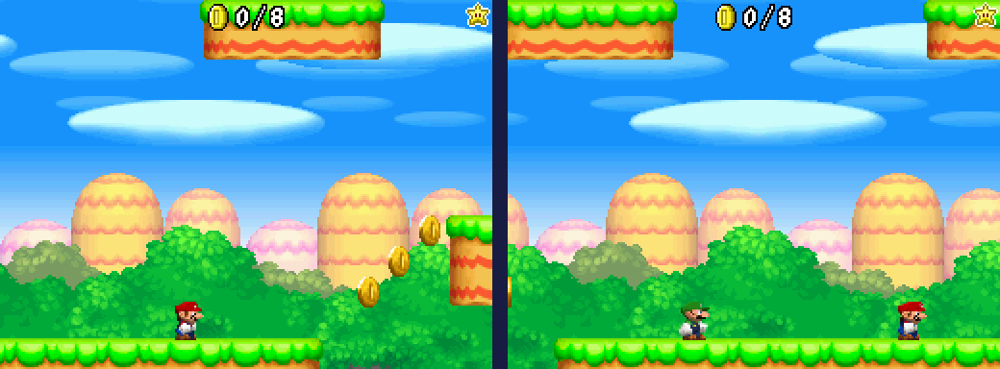
<details><summary>Kaart</summary>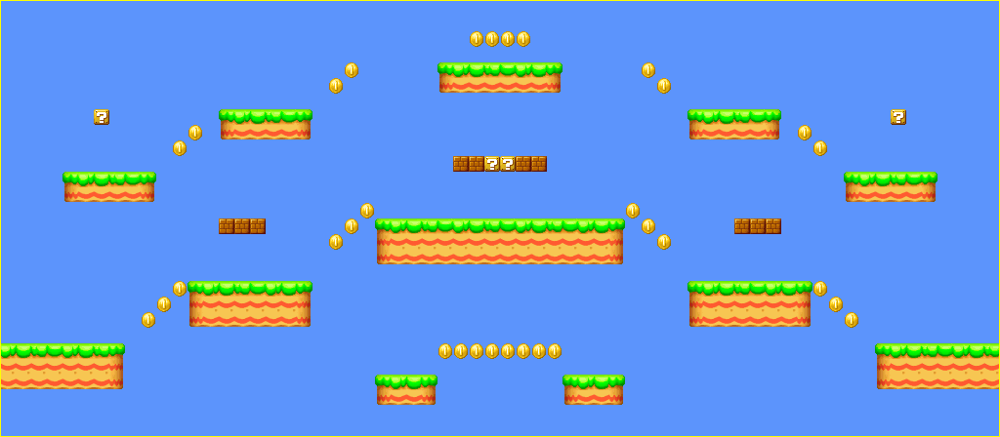</details>

#### Doolhof
Gangen op vier verdiepingen. De openingen verspringen per verdieping, dus de kortste weg is nooit recht omhoog.

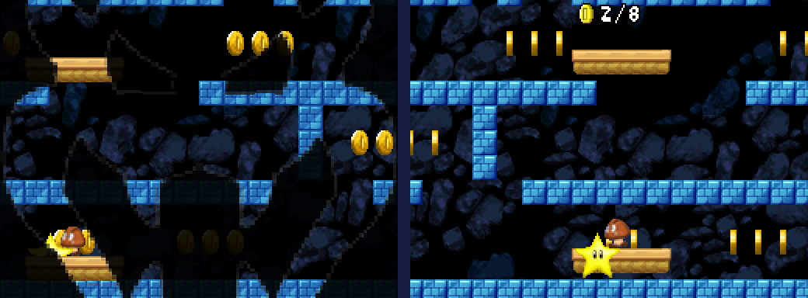
<details><summary>Kaart</summary></details>

#### Glijbaan
Twee ijstrappen glijden af naar een vallei. Wie te hard doorglijdt, valt naast de smalle ijsbrug.

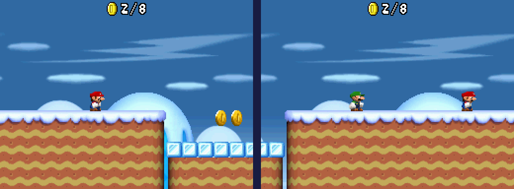
<details><summary>Kaart</summary>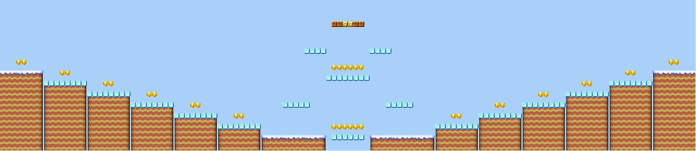</details>

#### Pijpenorgel
Rijen pijpen waarvan de hoogtes samen een golf vormen, met piranhaplanten in de laagste pijpen.

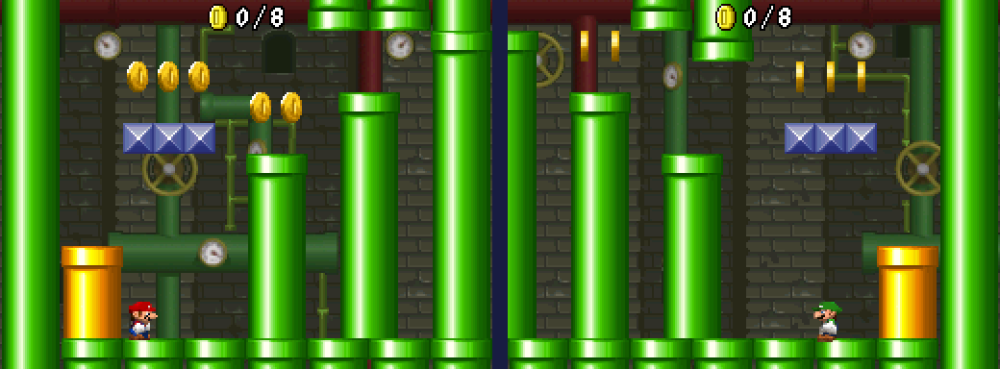
<details><summary>Kaart</summary>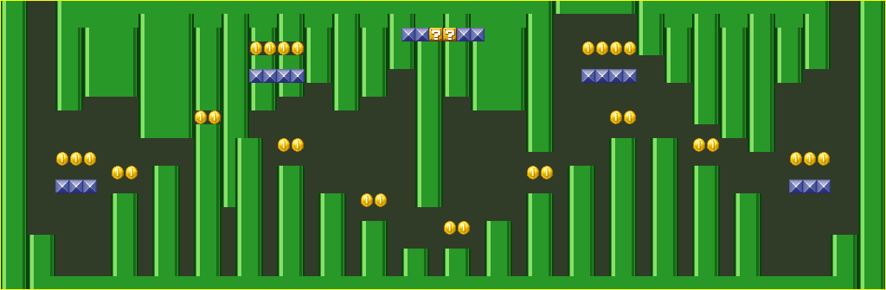</details>

#### Kerker
Een lage kerker met korte pilaren en bruggen op twee hoogtes.

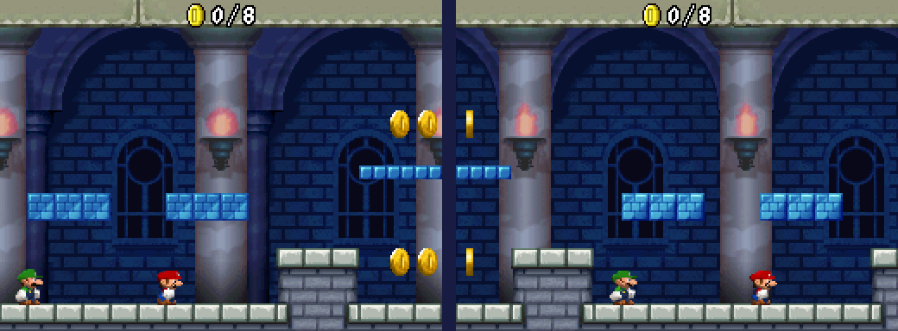
<details><summary>Kaart</summary>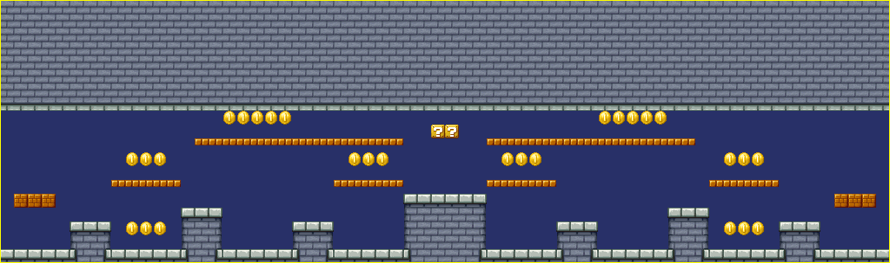</details>

### Pagina 4

#### Trappenpiramide
Een reusachtige trappiramide met een kroon van vraagtekenblokken en een leger Goomba's op de treden.

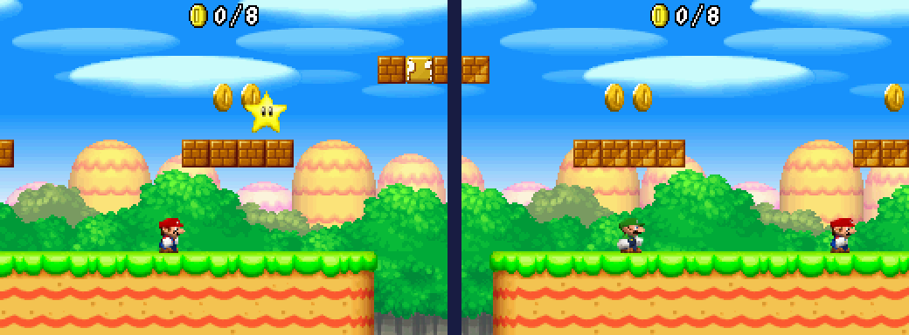
<details><summary>Kaart</summary></details>

#### Muntenkluis
Een kluis vol munten in het midden. Je komt er alleen in via het dak.

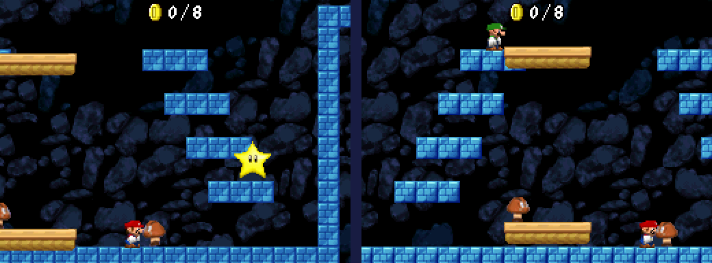
<details><summary>Kaart</summary></details>

#### Bevroren meer
De hele vloer is glad ijs, met sneeuwrotsen als obstakels.

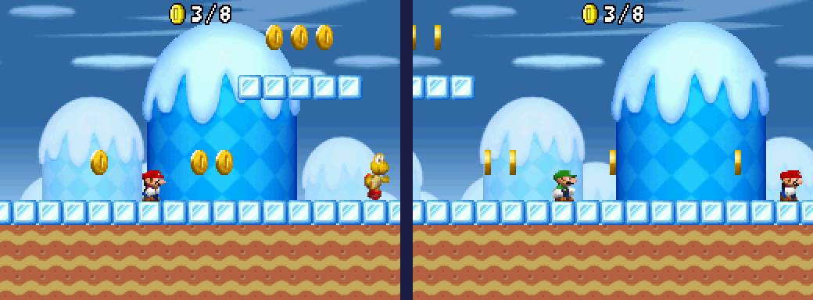
<details><summary>Kaart</summary>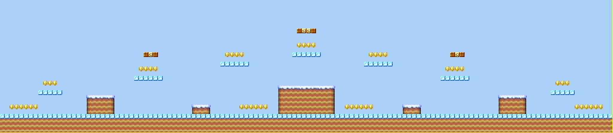</details>

#### Riool
Twee verdiepingen: een lage buis met piranhaplanten onderin en een loopbrug van noppenblokken erboven.

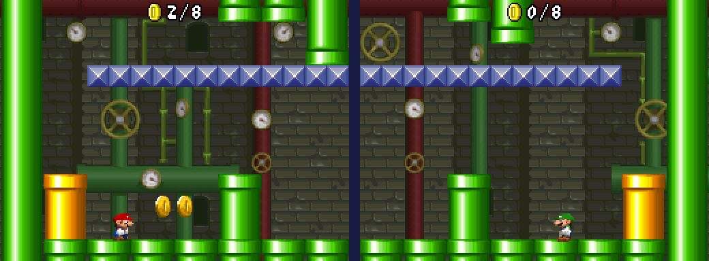
<details><summary>Kaart</summary>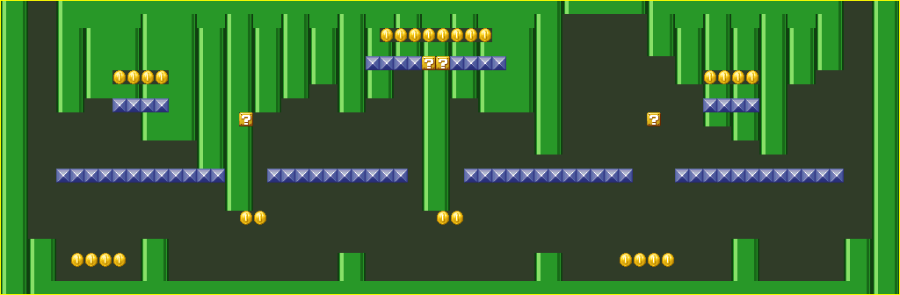</details>

#### Torenspits
Een kasteel zonder plafond, met een hoge middentoren, zijtorens en bruggen. Ook deze stage heeft een hogere camera.


<details><summary>Kaart</summary>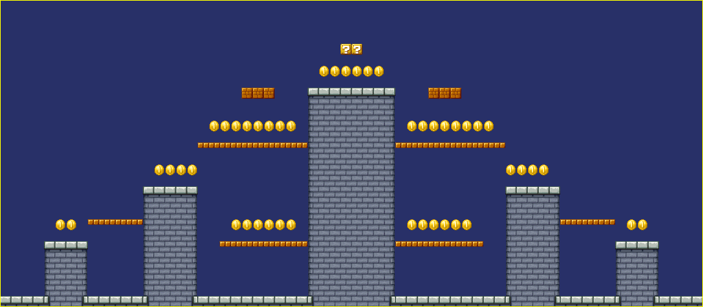</details>

## Bouwen

Je hebt nodig:

* Python 3.10 of nieuwer
* de Europese ROM `New Super Mario Bros. (Europe) (En,Fr,De,Es,It).nds` (SHA-1 `b0f7886720e842ed922569e1bb5c39c0fa090331`)
* optioneel `xdelta3` om ook een patchbestand te maken

```bash
pip install -r requirements.txt
python3 build.py "New Super Mario Bros. (Europe) (En,Fr,De,Es,It).nds"
```

Het resultaat komt in `out/`. Daar staan `StarShowdown.nds` (de ROM), `StarShowdown.xdelta` (een patch om te delen, alleen als xdelta3 geinstalleerd is) en de map `previews/` met een kaart per stage en de thumbnails.

Met `--keep-story` blijft de story mode staan; dan worden alleen de nieuwe stages toegevoegd.

### Een patch toepassen

Heb je alleen `StarShowdown.xdelta`? Pas die toe op de originele Europese ROM, bijvoorbeeld met `xdelta3 -d -s origineel.nds StarShowdown.xdelta StarShowdown.nds` of met een programma als Delta Patcher.

## Spelen

Mario vs Luigi heeft twee DS-systemen nodig. Op een emulator gaat dat met melonDS: kies in het eerste venster *System → Multiplayer → Launch new instance* en laad de ROM ook in het tweede venster. Kies in beide "Mario Vs. Luigi" en daarna "Compete with another New Super Mario Bros. owner". De host kiest de stage en bladert met L en R door de pagina's.

## Zelf stages toevoegen

Een stage is een Python-functie in `levels/stages.py` die een `StageBuilder` teruggeeft. Voeg de functie toe aan `PAGES` in `build.py`: vijf stages per pagina, maximaal vijf pagina's. De plek op de pagina bepaalt het thema. Er is dus nog ruimte voor een vijfde pagina.

Tijdens het ontwerpen helpt de renderer in `tools/nsmbgfx.py`: `build.py` schrijft van elke stage een kaart naar `out/previews/`.

## Hoe het werkt

In VS-modus laadt de game stages niet uit de gewone mappen maar uit een archief per thema (`ARCHIVE/Dat_Field.narc`, `Dat_Basement`, `Dat_Ice`, `Dat_Pipe` en `Dat_Fort`). Zo'n archief bevat de tileset, de achtergrond en de levelbestanden. De nieuwe stages worden aan het archief van hun thema toegevoegd, zodat tileset en vijanden altijd beschikbaar zijn.

De code-aanpassingen (Europese versie):

| Adres | Wat |
|---|---|
| `0x0219A100` | extra autoload-sectie van de ARM9 met eigen code, de paginavariabele, de bestandstabellen en de thumbnails van alle pagina's; de heap begint daardoor iets later (literal op `0x02055EF8`) |
| `0x02029D54` | tabel met archieven; de bovengrens van de vijf stage-archieven is verhoogd |
| ov052 `0x02160E54` | einde van `getStage()`: schrijft de bestands-ID's van de gekozen pagina in de coursetabel (`0x0202C8C4` en `0x0202C5DC`) |
| ov052 `0x02161B30` | update van het stagekeuzescherm: R en L bladeren door de pagina's en de thumbnails worden in VRAM bijgewerkt |
| ov052 `0x02161FAC` en `0x02161FC4` | Random kiest uit alle pagina's in plaats van vijf stages |
| ov009 `0x020E5148` | knop "Mario Game" springt naar Mario vs Luigi |
| `menu_title_E??.narc` bericht 12 | hinttekst voor L/R in vijf talen |
| banner | titel "Star Showdown" en een eigen icoon in het DS-menu |

De invoer in het stagekeuzemenu wordt tussen beide DS-systemen gesynchroniseerd, net als de toevalsgenerator. Daardoor komen beide spelers altijd in dezelfde stage terecht.

### Mappen

| Pad | Inhoud |
|---|---|
| `build.py` | bouwt de ROM en de patch |
| `levels/stages.py` | de ontwerpen van alle nieuwe stages als Python-code |
| `tools/nsmblevel.py` | lezen en schrijven van het levelformaat |
| `tools/nsmbgfx.py` | renderer voor kaarten en thumbnails |
| `tools/stagebuilder.py` | hulpfuncties voor het ontwerpen |
| `tools/codepatch.py` | ARM-assembly en code-patches |
| `tools/bmg.py` | bewerken van berichtbestanden |
| `tools/banner.py` | titel en icoon in het DS-menu |
| `tools/make_logo.py` | tekent het logo en het icoon |
| `docs/` | logo, screenshots en kaarten voor deze README |

## Getest

Alle vijftien nieuwe stages zijn gespeeld in een echte 2-speler sessie met twee melonDS-instanties (lokale draadloze verbinding), inclusief bladeren en Random. In DeSmuME zijn de stages ook in single-player gecontroleerd op tegels, vijanden en blokken. Titelmenu, Minigames en Options werken na het verwijderen van de story mode.

Nog niet getest zijn echte hardware en DS Download Play (spelen met iemand zonder cartridge). De nieuwe stages staan in dezelfde archieven die Download Play gebruikt, dus het zou moeten werken.

## Bekende beperkingen

* Op de knop in het titelmenu staat nog "Mario Game".
* Het "Ready!"-scherm en het uitslagscherm tonen de naam en afbeelding van de originele stage op dezelfde plek.
* Nieuwe thema's (zoals woestijn of lava) zijn niet mogelijk zonder extra archieven met tilesets en achtergronden.
* Alleen de Europese versie wordt ondersteund.

## Dank en licenties

Het levelformaat is gebaseerd op het werk van NSMB Editor (Dirbaio en anderen) en de NSMB Code Reference van het Mamma Mia Team. Het logo gebruikt het lettertype Lilita One (SIL Open Font License).

New Super Mario Bros., Mario en Luigi zijn handelsmerken van Nintendo. Star Showdown is een fanproject zonder banden met Nintendo. De screenshots en kaarten in `docs/` tonen de gemodde game; gebruik de hack alleen met een eigen exemplaar van het spel.
