<p align="center">
  
</p>

<p align="center">
  <b>A Mario vs Luigi rom hack for New Super Mario Bros. (DS, European version)</b><br>
  20 arenas &middot; without story mode &middot; ROM shrunk from 33.5 MB to 18 MB
</p>

---

**Star Showdown** is all about the Mario vs Luigi mode. On top of the five original stages there are fifteen new arenas, spread over four pages in the stage select menu. The story mode has been removed, which makes the ROM almost half the size.

This repository does not contain a ROM. The build script applies all changes to your own, legally obtained ROM.

## At a glance

| | |
|---|---|
| **Stages** | 20: the 5 originals plus 15 new ones |
| **Pages** | R goes to the next page, L to the previous one; the thumbnails change along |
| **Course: Random** | picks from all 20 stages |
| **Title screen** | the Star Showdown logo on the top screen and two buttons: Mario Vs. Luigi and Options |
| **ROM size** | 18 MB instead of 33.5 MB |
| **Version** | European ROM only (En, Fr, De, Es, It) |

Every slot on a page belongs to a theme: slot 1 is grass, 2 underground, 3 ice, 4 pipes and 5 castle. This way a new stage always uses the tileset, background and enemies that the game prepares for that theme.

## Title screen

The story mode and Minigames buttons are gone. The title menu shows "Mario Vs. Luigi" (selected by default) and "Options", and the top screen shows the Star Showdown logo instead of the original one.

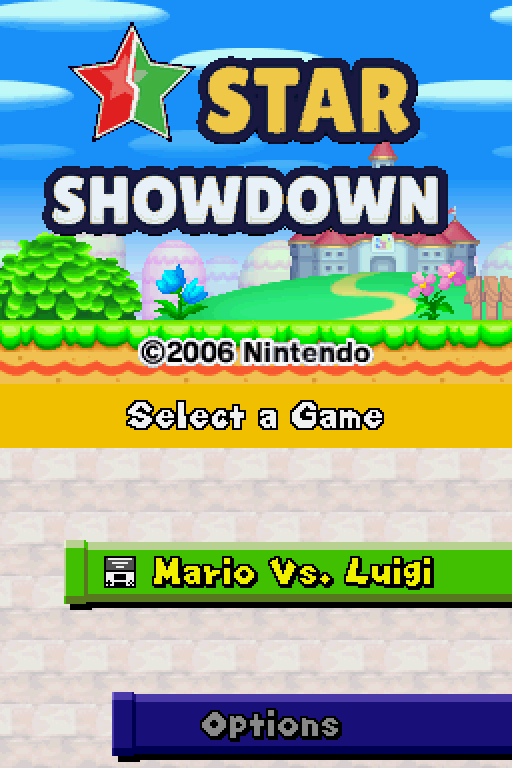

## The new stages

All screenshots come from a real two-player match: Mario's screen on the left, Luigi's on the right. Below every stage you can expand a map of the whole level.

### Page 2

#### Hilltop
A tall central hill with raised ends and three pits. The floating blocks are a stepping stone to the stars.


<details><summary>Map</summary>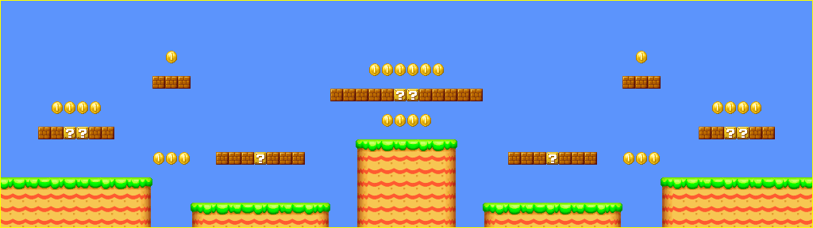</details>

#### Quarry
A symmetrical cave with ledges at five heights and a raised stone section in the middle.

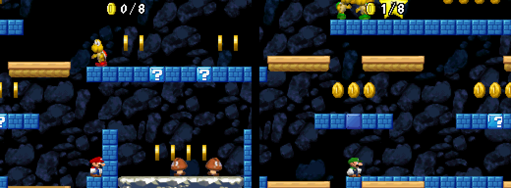
<details><summary>Map</summary>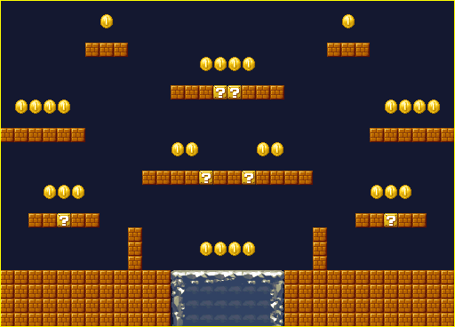</details>

#### Snowfield
A wide snowfield with ice platforms, height differences and three pits.

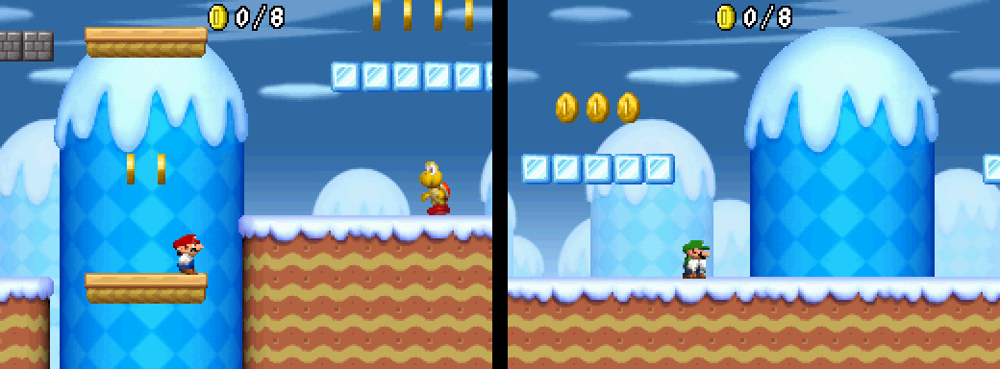
<details><summary>Map</summary>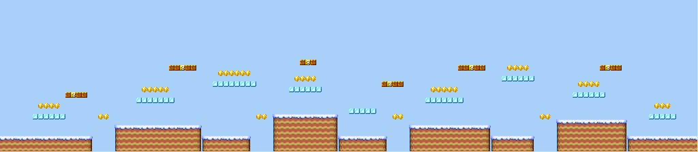</details>

#### Pipeworks
Pipes of different heights with Piranha Plants. The side warp pipes from the original stage are still there.

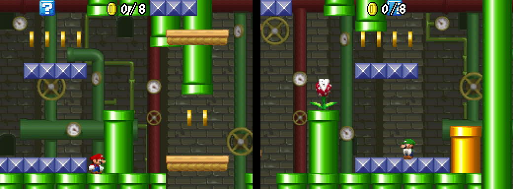
<details><summary>Map</summary>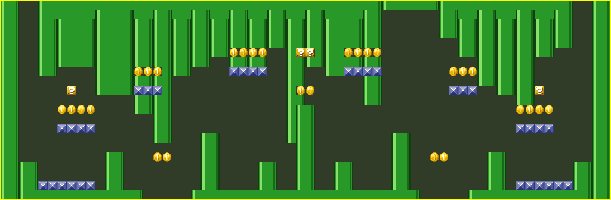</details>

#### Battlements
Four towers of rising height and a long bridge above a low middle wall.

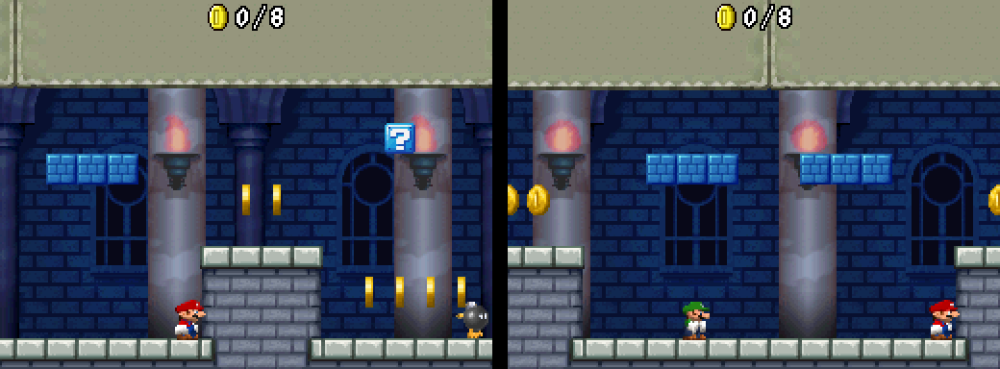
<details><summary>Map</summary>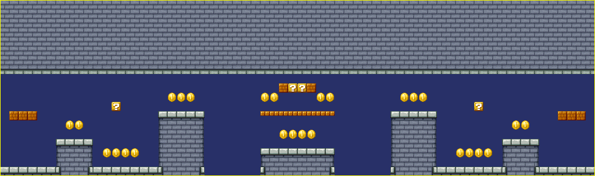</details>

### Page 3

#### Sky Islands
There is no ground: only grass islands floating above nothing. This stage has a taller camera than the original arenas.


<details><summary>Map</summary></details>

#### Labyrinth
Corridors on four floors. The openings shift on every floor, so the shortest way up is never straight up.


<details><summary>Map</summary>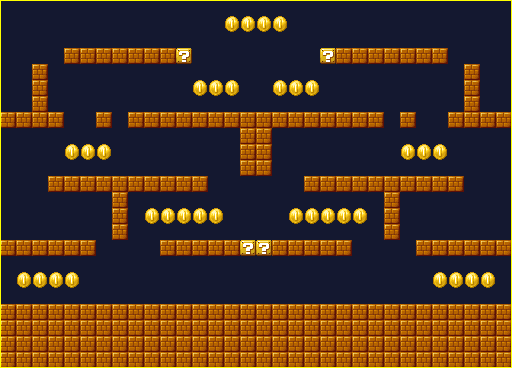</details>

#### Ice Slide
Two icy staircases slide down into a valley. Slide too fast and you drop through the gap next to the narrow ice bridge.

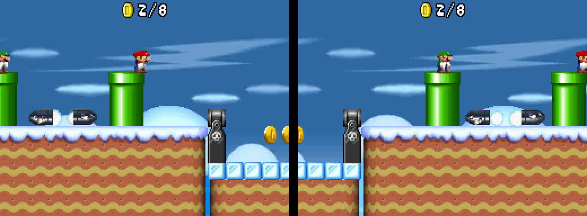
<details><summary>Map</summary>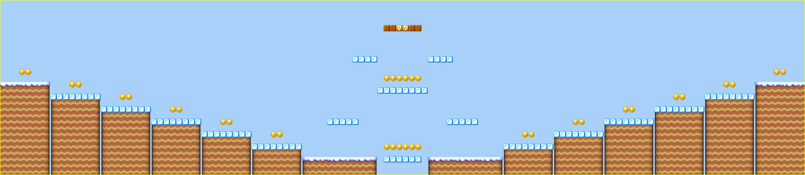</details>

#### Pipe Organ
Rows of pipes whose heights form a wave, with Piranha Plants in the lowest pipes.

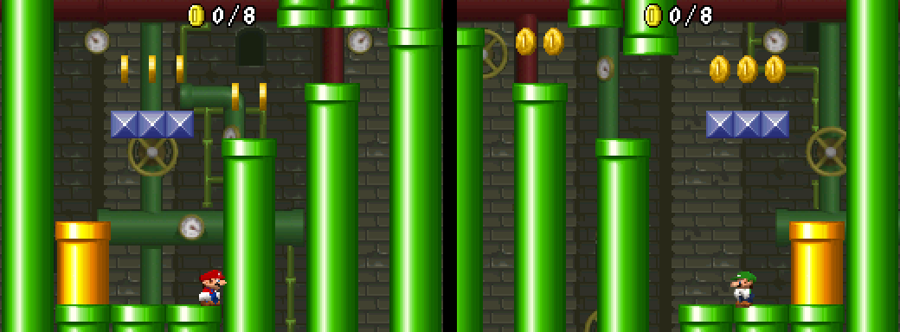
<details><summary>Map</summary></details>

#### Dungeon
A low dungeon with short pillars and bridges at two heights.


<details><summary>Map</summary></details>

### Page 4

#### Step Pyramid
A giant step pyramid with a crown of question blocks and an army of Goombas on its steps.

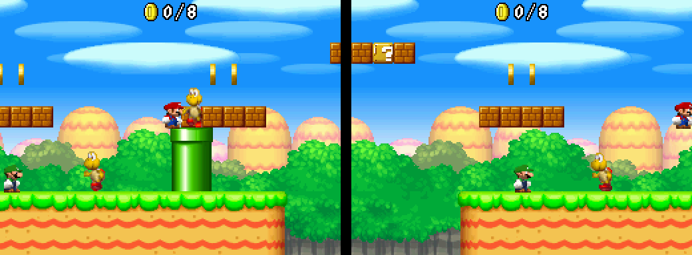
<details><summary>Map</summary>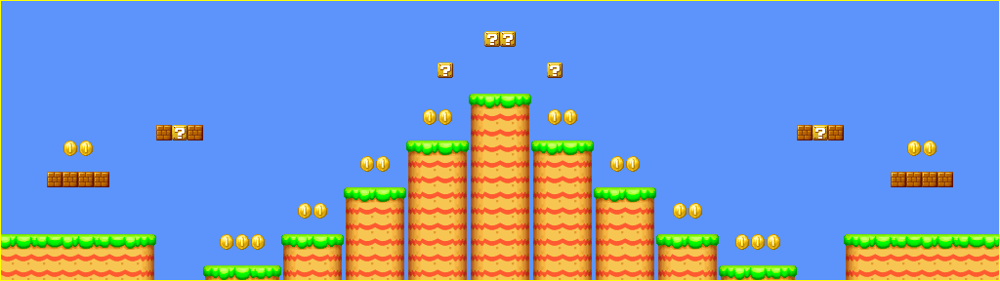</details>

#### Coin Vault
A vault full of coins in the middle. The only way in is through the roof.


<details><summary>Map</summary>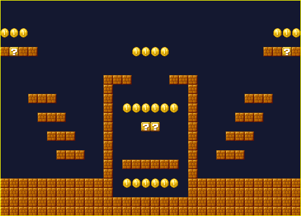</details>

#### Frozen Lake
The whole floor is slippery ice, with snow rocks as obstacles.

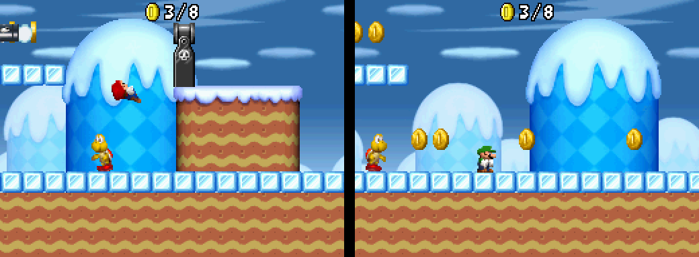
<details><summary>Map</summary>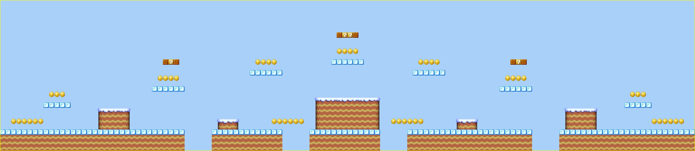</details>

#### Sewer
Two floors: a low tunnel with Piranha Plants at the bottom and a walkway of studded blocks above it.

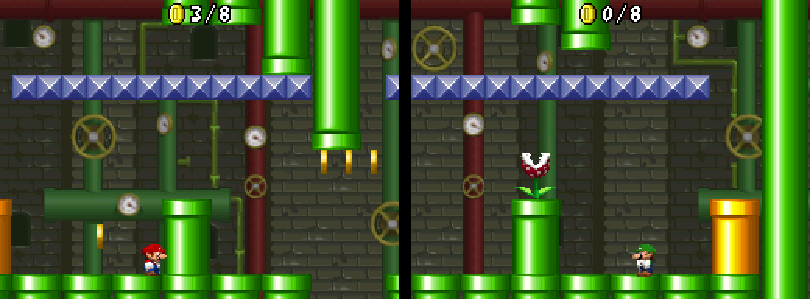
<details><summary>Map</summary>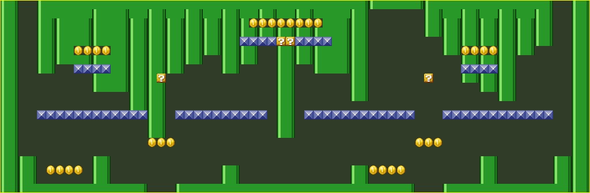</details>

#### Spire
A castle without a ceiling, with a tall central tower, side towers and bridges. This stage also has a taller camera.

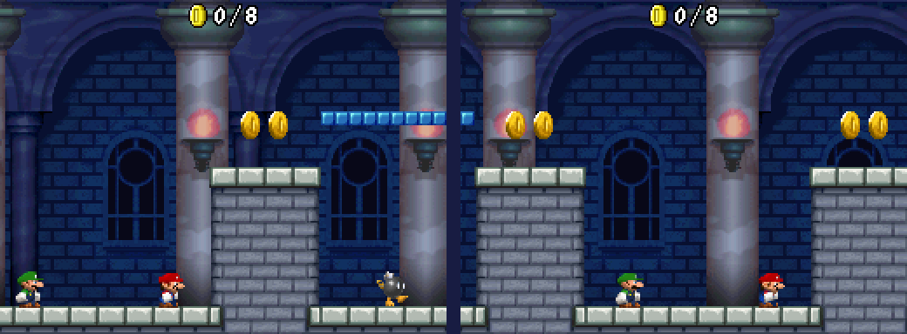
<details><summary>Map</summary>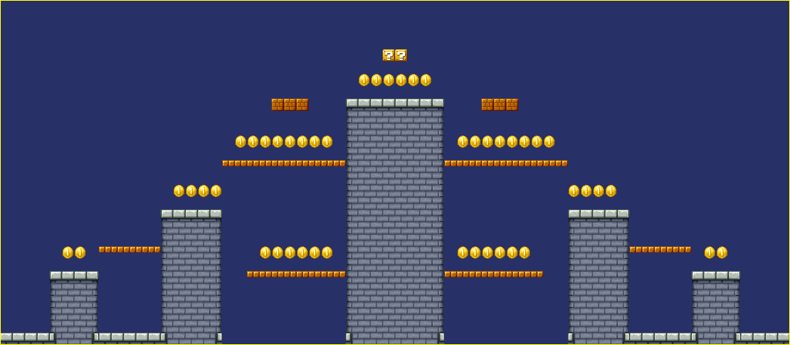</details>

## Building

You need:

* Python 3.10 or newer
* the European ROM `New Super Mario Bros. (Europe) (En,Fr,De,Es,It).nds` (SHA-1 `b0f7886720e842ed922569e1bb5c39c0fa090331`)
* optionally `xdelta3` to also create a patch file

```bash
pip install -r requirements.txt
python3 build.py "New Super Mario Bros. (Europe) (En,Fr,De,Es,It).nds"
```

The result ends up in `out/`: `StarShowdown.nds` (the ROM), `StarShowdown.xdelta` (a patch to share, only if xdelta3 is installed) and the folder `previews/` with a map of every stage and the thumbnails.

With `--keep-story` the story mode stays in; only the new stages are added.

### Applying a patch

Only have `StarShowdown.xdelta`? Apply it to the original European ROM, for example with `xdelta3 -d -s original.nds StarShowdown.xdelta StarShowdown.nds` or with a tool such as Delta Patcher.

## Playing

Mario vs Luigi needs two DS systems. On an emulator you can use melonDS: in the first window choose *System → Multiplayer → Launch new instance* and load the ROM in the second window as well. Pick "Mario Vs. Luigi" in both and then "Compete with another New Super Mario Bros. owner". The host chooses the stage and uses L and R to flip through the pages.

## Adding your own stages

A stage is a Python function in `levels/stages.py` that returns a `StageBuilder`. Add the function to `PAGES` in `build.py`: five stages per page, at most five pages. The slot on the page decides the theme. There is still room for a fifth page.

The renderer in `tools/nsmbgfx.py` helps while designing: `build.py` writes a map of every stage to `out/previews/`.

## How it works

In VS mode the game does not load stages from the regular folders but from one archive per theme (`ARCHIVE/Dat_Field.narc`, `Dat_Basement`, `Dat_Ice`, `Dat_Pipe` and `Dat_Fort`). Such an archive holds the tileset, the background and the level files. The new stages are added to the archive of their theme, so the tileset and enemies are always available.

The code changes (European version):

| Address | What |
|---|---|
| `0x0219A100` | extra ARM9 autoload section with our own code, the page variable, the file tables and the thumbnails of all pages; the heap starts a little later because of it (literal at `0x02055EF8`) |
| `0x02029D54` | archive table; the upper bound of the five stage archives is raised |
| ov052 `0x02160E54` | end of `getStage()`: writes the file IDs of the chosen page into the course table (`0x0202C8C4` and `0x0202C5DC`) |
| ov052 `0x02161B30` | stage select update: R and L flip through the pages and the thumbnails are updated in VRAM |
| ov052 `0x02161FAC` and `0x02161FC4` | Random picks from all pages instead of five stages |
| ov009 `0x020E18E0`, `0x020E52B0`, `0x020E5364`, `0x020E5924` | the title menu only draws and accepts the "Mario Vs. Luigi" and "Options" buttons, the d-pad jumps between them and Mario Vs. Luigi is selected by default; `0x020E5148` also sends the old "Mario Game" case to Mario vs Luigi |
| `UI_O_menu_title_logo_o_u_ncg.bin.E??` and `d_2d_UI_O_menu_title_logo_o_u_ncl.bin` | the Star Showdown logo on the top screen (tiles and two palettes) |
| `menu_title_E??.narc` message 12 | L/R hint text in five languages |
| banner | the title "Star Showdown" and a custom icon in the DS menu |

The input in the stage select menu is synchronised between both DS systems, just like the random number generator. That is why both players always end up in the same stage.

### Files

| Path | Contents |
|---|---|
| `build.py` | builds the ROM and the patch |
| `levels/stages.py` | the designs of all new stages as Python code |
| `tools/nsmblevel.py` | reading and writing the level format |
| `tools/nsmbgfx.py` | renderer for maps and thumbnails |
| `tools/stagebuilder.py` | helpers for designing stages |
| `tools/codepatch.py` | ARM assembly and code patches |
| `tools/bmg.py` | editing message files |
| `tools/banner.py` | title and icon in the DS menu |
| `tools/make_logo.py` | draws the logo, the icon and the title screen art |
| `tools/titlescreen.py` | puts the logo into the title screen graphics |
| `assets/` | title screen art (star and text layer) |
| `docs/` | logo, screenshots and maps for this README |

## Tested

All fifteen new stages were played in a real two-player session with two melonDS instances (local wireless), including flipping pages and Random. The stages were also checked in single player in DeSmuME for tiles, enemies and blocks. The title screen was tested in DeSmuME: Mario Vs. Luigi and Options both work, the d-pad jumps between them and tapping where the removed buttons used to be does nothing.

Not tested yet: real hardware and DS Download Play (playing with someone who does not have the cartridge). The new stages are in the same archives that Download Play uses, so it should work.

## Known limitations

* On the title menu there is an empty spot between Mario Vs. Luigi and Options where Minigames used to be.
* The "Ready!" screen and the results screen show the name and picture of the original stage in the same slot.
* New themes (such as desert or lava) are not possible without extra archives with tilesets and backgrounds.
* Only the European version is supported.

## Credits and licences

The level format is based on the work of NSMB Editor (Dirbaio and others) and the NSMB Code Reference by the Mamma Mia Team. The logo uses the Lilita One font (SIL Open Font License).

New Super Mario Bros., Mario and Luigi are trademarks of Nintendo. Star Showdown is a fan project that is not affiliated with Nintendo. The screenshots and maps in `docs/` show the modded game; only use the hack with your own copy of the game.
